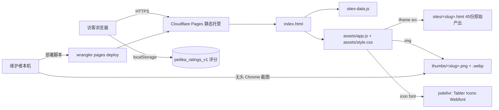
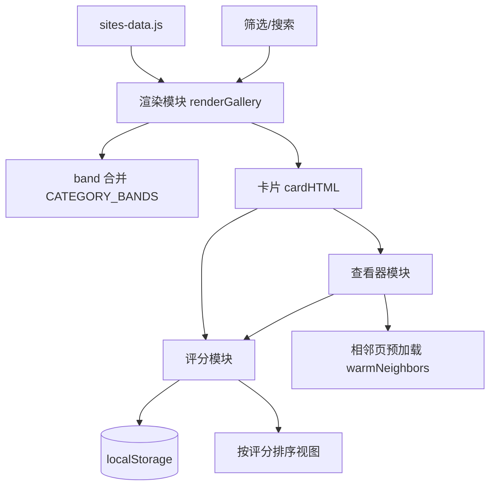

# 系统架构

## 架构总览



数据流：浏览器加载 `index.html` → 执行 `sites-data.js` 得到 `window.SITES` 数组 → `assets/app.js` 按分类渲染卡片网格（缩略图来自 `thumbs/`，卡片点击后 iframe 加载 `sites/<slug>.html`）→ 评分读写只在浏览器 `localStorage`，**没有任何后端、数据库或服务端接口**。部署由维护者本机用 `wrangler` 把 `02-TempFiles/dist` 推到 Cloudflare Pages。

## 目录结构

```
03-鹈鹕自行车测试/
├─ index.html              # 页面骨架：header(搜索+排序+导出)、filter-bar、galleryRoot、viewer 三帧查看器
├─ sites-data.js           # 唯一数据源：window.SITES，45 条（数组顺序 = 展厅与查看器翻页顺序）
├─ favicon.webp            # 站点 favicon 与左上角品牌图标（同一张）
├─ assets/
│  ├─ style.css            # 浅色主题、卡片网格、查看器、移动端断点 720px
│  └─ app.js               # 渲染、筛选搜索、评分、排序、band 合并、查看器预加载
├─ sites/                  # 45 个 ASCII 命名干净副本（部署用，查看器 iframe 直接加载）
├─ thumbs/                 # 90 个缩略图：每个 slug 一份 png（静态）+ 一份 webp（8 帧动画）
├─ OpsDev/deploy-pages.sh  # 构建 02-TempFiles/dist 并 wrangler 部署到 Cloudflare Pages
├─ 03-TempScr/             # 维护脚本：缩略图生成、元数据回填、重排、CDP 交互校验
├─ 02-TempFiles/           # 临时产物：dist 部署包、校验截图、Chrome 调试 profile、数据备份
├─ 01-ProjectDoc/          # 需求排期与验证记录（各模型产出的需求文档）
├─ ProjectDoc/             # 本交接文档集（legacy/ 为旧版单文件备份）
├─ TempScr/ TempFiles/     # 早期遗留临时目录（旧脚本与旧截图）
├─ Trash/                  # 下架条目的备份（可恢复）
└─ 根目录中文名 HTML        # 各模型原始产出原件（禁止修改，仅作对比源与副本来源）
```

> `02-TempFiles/` 下的 `chrome-profile-*` 是 Chrome 调试用的 user data dir（体积大、含浏览器缓存），不是项目内容，清理时可直接删。

## 原生/嵌入式/本地推理

不适用。本项目为纯前端静态站点，无编译产物、无嵌入式固件、无本地推理模型。扫描器在 `02-TempFiles/chrome-profile-*` 里命中的 Make/Ninja/Arduino 线索均来自 Chrome 扩展缓存，与项目无关。

## 技术选型与路线

- **纯静态、零构建**：展厅只需对比「模型产出的原始 HTML」，任何框架/打包都会污染对比对象；因此前端保持原生 JS，无 package.json。
- **副本而非改造原件**：根目录原件禁止修改，展示用 `sites/` 下的 ASCII 副本（`slug` 必须是 ASCII，否则部署路径会出问题）。
- **缩略图自制而不外链**：用无头 Chrome 自截 + Pillow 合成动画 WebP，保证 45 张风格一致（曾尝试外链图床方案，已放弃）。
- **评分存 localStorage**：无后端，故评分只在本机生效；`DEFAULT_RATINGS` 作为新访客的展示基线，由导出 JSON 回填。
- **分类并列（band）**：小分类两两共用一行网格，先做过「auto-fit 拉宽」方案，用户否掉后改成「每组占位块 + 显式并列配置」，见「扩展与替换点」。

## 外部资源依赖

| 类型 | 资源 | 说明 |
|---|---|---|
| CDN 外链 | `https://cdn.jsdelivr.net/npm/@tabler/icons-webfont@latest/tabler-icons.min.css` | 唯一运行期外部依赖：Tabler 图标字体（`index.html` 引入），用于头部/按钮/卡片图标。加载失败只影响图标显示，不影响功能；国内可访问性未做镜像兜底，需离线化时下载到本地 `assets/` 并改 `<link>` |
| 模型产出页面内的 CDN（非展厅依赖） | `https://cdnjs.cloudflare.com/ajax/libs/three.js/r128/three.min.js` 等多个 three.js 版本（另有 `unpkg`、`cdn.jsdelivr.net` 源） | 这些外链出现在 `sites/` 下**各模型自己产出的页面内部**，是对比对象的一部分，不是展厅自身依赖；某模型页面加载 three.js 失败会表现为该卡片内容异常，属正常对比结果 |

## 局域网访问

无。本地静态服务绑定 `127.0.0.1`，不对外暴露；生产访问全部走 Cloudflare Pages 公网域名。扫描命中的 `0.0.0.0` 线索来自 `02-TempFiles/chrome-profile-*` 里的浏览器扩展脚本，与项目无关。

## AI 工具链

本交接文档生成过程中实际使用：

- **skill `project-handoff`**：扫描项目、生成/更新 `ProjectDoc/` 文档集并验收。
- **skill `byted-web-search`（豆包搜索）**：检索各模型参数规模/知识截止/发布时间（中文与国内资料）。
- **skill `firecrawl`**：抓取 DataLearner 模型页正文，取搜索摘要里没有的精确字段（知识截止等）。
- **Chrome DevTools Protocol（自写脚本，位于 `03-TempScr/`）**：模拟点击/打分/翻页做真实浏览器验证，端口 9303 为本项目惯用（9300/9302 常被其他项目占用）。

未使用任何 MCP server 或子 agent 完成本项目的代码改动。

## 开发环境痕迹

- 原开发平台：Windows 11（Git Bash + PowerShell 混用），路径含中文（这是历史上 npm/pnpm 出 MAX_PATH 问题的原因，也是本项目坚持 ASCII slug 的原因）。
- 工具：系统 Chrome（`C:\Program Files\Google\Chrome\Application\chrome.exe`）、托管 Python 3.13（`C:\Users\mypra\.workbuddy\binaries\python\envs\default`，装了 Pillow）、托管 Node 22、全局 npm 的 `wrangler`。
- 接手方至少要有：Chrome（截图/校验）、wrangler（部署）、任一 Python（起本地静态服务）。其余脚本只能用 Windows 路径运行。

## 模块总览



主执行链路：`sites-data.js`（数据）→ `renderGallery`（按分类分组 + band 合并 → 卡片 HTML）→ 卡片事件（打开查看器/打分）→ 查看器 `loadCurrent/warmNeighbors`（三帧 iframe 轮转）→ 评分 `saveRating`（localStorage + 卡片/查看器双向同步）。

## 模块职责矩阵

| 模块 | 职责 | 入口文件 | 上游 | 下游 | 关键配置 | 测试 |
|---|---|---|---|---|---|---|
| 数据层 | 45 条站点元数据，决定展示与翻页顺序 | `sites-data.js` | 人工维护 | 渲染模块 | `slug/src/thumb/category` 路径约定 | `03-TempScr/10月5日-2335-本次改动冒烟.js` |
| 渲染与分组 | 按分类分组、并列 band 合并、卡片 HTML | `assets/app.js` `renderGallery` | 数据层、筛选模块 | 事件绑定 | `CATEGORY_BANDS`（app.js:258 起） | 整页截图 + dump-dom 校验 section 数 |
| 筛选与搜索 | 分类 chip、关键词搜索 | `assets/app.js` | 用户输入 | 渲染模块 | 搜索字段：model/category/file | 人工验证 |
| 评分 | 1-10 分读写、默认基线、导出导入、按分排序 | `assets/app.js`（`RATINGS_KEY`=app.js:48，`DEFAULT_RATINGS`=app.js:51） | 卡片/查看器 | `localStorage` | 键 `peilika_ratings_v1` | `03-TempScr/10月5日-2110-展厅查看器交互校验.js` |
| 查看器 | iframe 全屏查看、翻页、预加载、键盘 | `assets/app.js` `openViewer/loadCurrent/warmNeighbors` | 卡片点击 | `sites/*.html` | 三帧 `viewerIframe/Prev/Next` | `03-TempScr/10月5日-2120-查看器二次打开复测.js` |
| 缩略图生成 | 无头 Chrome 截图 + Pillow 合成动画 WebP | `03-TempScr/10月5日-1815-生成展厅缩略图.py` | `sites/*.html` | `thumbs/*.png|.webp` | 1280×900、8 帧、每帧 260ms | 脚本已生成 45 组，产物人工抽查 |
| 部署 | 构建 dist + wrangler 推送 | `OpsDev/deploy-pages.sh` | 工作区文件 | Cloudflare Pages | `--project-name peilika` | 每次部署后 curl 校验 |

## 关键调用链

1. 展厅加载：`index.html` → `sites-data.js`（`window.SITES`）→ `assets/app.js` 的 `renderGallery()` → `cardHTML()` → `bindCards()` → `bindRatings()`
2. 打开页面：点击卡片 → `openViewer(slug)` → `loadCurrent()` → iframe `src = s.src` + `warmNeighbors()` 预加载前后页
3. 打分同步：星星点击 → `applyRating/saveRating` → 写 `localStorage` → `refreshCardRating()` 更新卡片 → 查看器内 `updateViewerRating()`
4. 翻页：`prev()/next()` → 若目标页已在预加载帧则切 class `is-current`（瞬时），否则 `loadCurrent()` 重新加载并再次预热
5. 部署：`OpsDev/deploy-pages.sh` → 复制 index/sites-data/assets/sites/thumbs(png+webp) 到 `02-TempFiles/dist` → `wrangler pages deploy --project-name peilika`

## 共享状态与数据边界

- `window.SITES`（全局）：只读，渲染与查看器共用；数组顺序即展示与翻页顺序。
- `localStorage.peilika_ratings_v1`：唯一可变共享状态，单浏览器内跨卡片/查看器共享；清除记 `0`（不会被默认分覆盖）。
- 查看器三帧 iframe 共享 `data-current-index`/`data-src` 记账属性，关闭时全部重置为 `about:blank`（避免残留导致二次打开串页）。
- 无并发问题（纯静态、无服务端）。

## 扩展与替换点

- **改分类顺序 / 并列组合**：改两处——`sites-data.js` 数组顺序（组内顺序跟着走），与 `assets/app.js` 的 `CATEGORY_BANDS`（并列配对，如 `['智谱 · GLM','腾讯 · 混元']`）。
- **新增/下架条目**：只改 `sites-data.js` + `sites/` + `thumbs/`（详见 usage.md 流程 3/4）。
- **缩略图规格**：改 `03-TempScr/10月5日-1815-生成展厅缩略图.py` 的 `SLUGS`、`BUDGETS`（8 个时间点采样）、`duration`；脚本对已存在的图会跳过，重截需先删。
- **渠道标签**：界面已移除 `channel-badge` 渲染，`channelClass()` 与 `ch-*` 样式仍在；要恢复显示只需在 `assets/app.js` 的 `cardHTML()` 里加回一个 `<span>`。
- 无插件机制、无适配器接口，扩展靠直接改上述文件。
